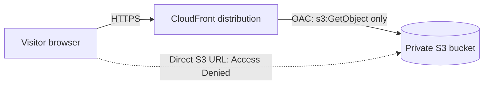

# Secure Static Website on AWS (S3 + CloudFront)

A personal "cloud journey" page hosted on a **private S3 bucket** and served globally over **HTTPS through CloudFront**, using Origin Access Control (OAC). Built as my first hands-on AWS project while moving from service desk (8+ years) into cloud engineering.

**Live site:** https://d3hczph15si19v.cloudfront.net

## Architecture

## Services used

|Service|Purpose|
|-|-|
|**Amazon S3**|Stores `index.html` in a private bucket|
|**Amazon CloudFront**|CDN that serves the page over HTTPS|
|**Origin Access Control (OAC)**|Lets only my distribution read the bucket|
|**IAM / bucket policy**|Least-privilege access rules|
|**AWS CloudTrail (Event history)**|Reviewed account activity at no cost|

## What I did

1. Created an AWS account on the free plan and enabled **MFA**.
2. Built a one-page site (`index.html`).
3. Created an S3 bucket (general purpose, **ACLs disabled**, **Block all public access ON**, SSE-S3 encryption).
4. Uploaded `index.html` to the bucket.
5. Created a CloudFront distribution with the bucket as origin and **private bucket access (OAC)** enabled.
6. Set the **default root object** to `index.html`.
7. Reviewed the generated bucket policy and tested the result.

## Security decisions

* **Bucket stays private.** Block Public Access is on.
* **Least privilege.** The bucket policy allows only `s3:GetObject`, only for the CloudFront service, and only from my distribution (`AWS:SourceArn` condition).
* **HTTPS** is served by CloudFront.
* **WAF skipped** on purpose: it is usage-based and this small static site has little to protect.

## Testing

|Test|Result|
|-|-|
|Open the CloudFront URL|Page loads over HTTPS|
|Open the direct S3 object URL|`AccessDenied` (bucket is private)|

!\[Access Denied on direct S3 URL](screenshots/s3-access-denied.png)

## Cost

Free plan and credits. No trails, Insights, or WAF were enabled, so the cost stayed at $0.

## Challenges and lessons learned

* The console layout was newer than many tutorials, so I had to read each screen carefully instead of following steps blindly.
* The **default root object** was not in the creation wizard, so I set it afterwards in the distribution settings.
* I learned why the bucket policy `Condition` matters: it stops other people's CloudFront distributions from reading my bucket.

## Next steps

* \[ ] Rebuild the same setup with **Terraform**
* \[ ] Add a **GitHub Actions** workflow to deploy on every push
* \[ ] Practice a CloudFront **invalidation** after editing the page
* \[ ] Add a Python/Lambda automation

\---

*Built by Fran. Starter page written with help from Claude.*

